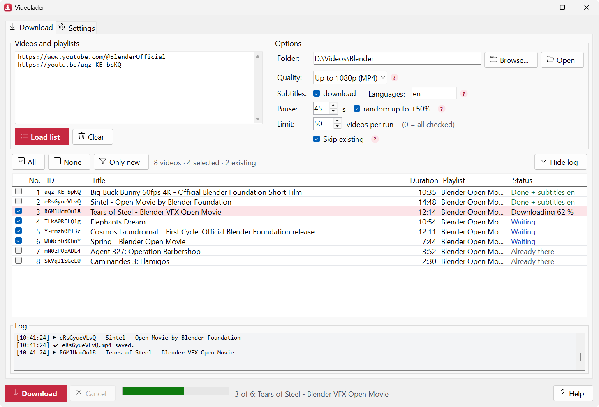
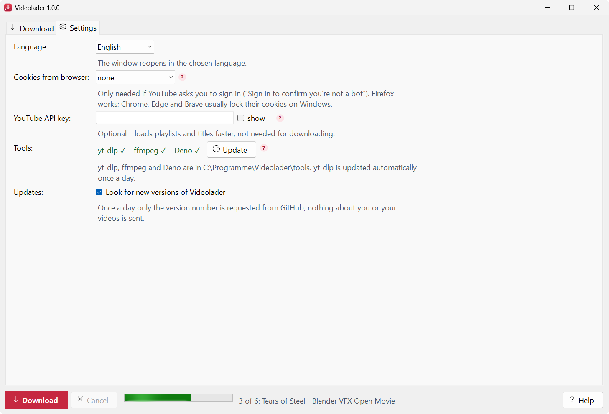
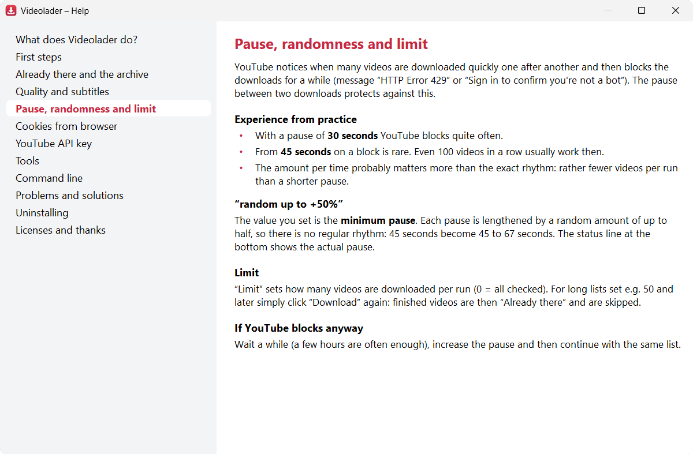

**English** | [Deutsch](README.de.md) | [Русский](README.ru.md)

# Videolader

[](https://github.com/Schelawski/Videolader/actions/workflows/build.yml)

A small Windows desktop app that downloads YouTube videos and whole playlists. The files are named
after the **video ID**, next to them are a metadata file and, if you want, the subtitles in Whisper
JSON format. Videos you already have are recognized and skipped.



> **Videolader is free of charge.** The only official source is this repository,
> [github.com/Schelawski/Videolader](https://github.com/Schelawski/Videolader). Copies from other
> sources may have been changed.

## Download

**[Download Videolader.exe](https://github.com/Schelawski/Videolader/releases/latest/download/Videolader.exe)** –
always the newest version. No installation needed: start it, let **Settings → Tools → Set up…**
download the tools, done. All versions and their changes: [Releases](https://github.com/Schelawski/Videolader/releases).

Requirements: Windows 10 or 11, 64-bit. Each release also contains `Videolader.exe.sha256`; to check the
download, run `Get-FileHash Videolader.exe` in PowerShell and compare the value. On the first start Windows
may show “Windows protected your PC” – click “More info” → “Run anyway” (see the help topic “Problems and
solutions”).

## Features

- **Videos, playlists and channels** – paste links or IDs, one per line; playlists are expanded and
  duplicates merged.
- **Never twice:** videos in the folder or in `videolader-archiv.txt` are skipped, even if you moved them
  elsewhere.
- Files named by video ID, metadata in `<ID>.info.json`, subtitles as Whisper JSON and SRT.
- Quality from “Up to 480p” to “Best quality”, or audio only (M4A).
- **Pause between downloads** with a random extra of up to 50 % and a **limit per run**, so YouTube does not
  block the downloads (see [Practical tips](#practical-tips)).
- Stops right away if the browser cookies cannot be read, and offers to turn them off.
- User interface, command line and help in **English, German and Russian**. The language follows Windows
  on the first start (German or Russian, otherwise English) and can be switched under **Settings → Language**.
- Built-in **help** (button “Help”, F1, or the small “?” next to the settings).
- Downloads yt-dlp, ffmpeg and Deno itself and checks them against the published SHA-256 checksums.
- **Command line** for scripts and the Task Scheduler.
- One self-contained `Videolader.exe` – no .NET installation needed.

## Usage

1. Paste links or IDs into the box “Videos and playlists”, one per line. Recognized are video links
   (`watch?v=`, `youtu.be/`, `shorts/`, `live/`), video IDs, playlist links and IDs (`PL…`) and channels
   (link, `@name` or channel ID `UC…`; the channel's “Videos” tab is loaded – Shorts and live streams are
   separate tabs and need their own line with `…/shorts` or `…/streams`).
2. **Load list** (or Ctrl+Enter). Playlists are expanded, duplicate videos merged. Each video gets a status:
   **New**, **Already there** or **Not available** (private or deleted).
3. Check the videos. “Only new” checks everything that is still missing. Space and right click act on the
   selected rows, a double click opens the video in the browser.
4. **Download**. The videos are downloaded one after another, with an adjustable pause in between. An error
   does not stop the list.

“Already there” means: the folder contains `<ID>.mp4` (or `.m4a`, `.mkv` …) **or** the ID is listed in
`videolader-archiv.txt`. So you can move finished videos elsewhere and they are still not downloaded again.
If you want a video again on purpose, delete its line from the archive file.

### Settings

Folder, quality, subtitles, pause and limit are on the **Download** tab next to the input box. Rarely used
things (language, cookies, API key, tools) are on the **Settings** tab. “Hide log” folds the log away and
gives the list more room.



| Setting | Meaning |
|---|---|
| Folder | Where the videos go. Default: `Videos\Videolader`. |
| Quality | Best, up to 1080p (default), up to 720p, up to 480p or audio only. |
| Subtitles / Languages | e.g. `ru` or `ru,de,en`. Uploaded subtitles take priority over automatic ones. Note: for automatic subtitles in foreign languages YouTube delivers machine translations. |
| Pause | Seconds between two downloads, protects against YouTube's throttling (HTTP 429). With “random up to +50%” (default) the value is the minimum pause and each pause is lengthened by a random amount of up to half (45 s → 45 to 67 s), so there is no regular rhythm. Also applies to the command line. |
| Limit | At most this many videos per run (0 = all). For long lists e.g. 50, and next time simply continue: finished videos are in the archive and are skipped. |
| Cookies from browser | Only needed if YouTube reports “Sign in to confirm you're not a bot”. Firefox works most reliably: Chrome, Edge and Brave lock their cookies on Windows while the browser is running and encrypt them so that yt-dlp usually cannot read them (“Could not copy Chrome cookie database”). Then the download stops right away and Videolader offers to turn the cookies off. |
| YouTube API key | Optional. Playlists and titles are then read through the official API (fast, 1 quota unit per 50 videos). Without a key, yt-dlp or YouTube's oEmbed interface does this. **The key is not needed for downloading**, because the API delivers no video files. |

The settings are stored in `Videolader.settings.json` next to the exe (or in `%APPDATA%\Videolader` if
that folder is read-only). The API key is encrypted there with Windows DPAPI for your user account; on
another account or computer it has to be entered again.

### Practical tips

- With a pause of **30 seconds** YouTube blocks the downloads quite often. From **45 seconds** on a block
  is rare – even 100 videos in a row usually work.
- The amount per time probably matters more than the exact rhythm: for long lists rather use the
  **limit** (e.g. 50 per run) than a shorter pause.
- Usually you need **no cookies**. If you do, use Firefox.

### Help

The built-in help explains every setting and the typical problems in plain language, in all three
languages. It opens with the button “Help”, with F1 (matching the field you are in) or with the small “?”
next to the settings. The texts are in `src/Videolader.Core/Help/help.{en,de,ru}.md`.



## What you get for each video

```
D:\Videos\Blender\
  aqz-KE-bpKQ.mp4           video (H.264 + AAC, with “Audio only”: .m4a)
  aqz-KE-bpKQ.info.json     ID, title, channel, date, duration, description, playlist, subtitles
  aqz-KE-bpKQ.en.json       subtitles in Whisper format (optional)
  aqz-KE-bpKQ.en.srt        the same subtitles as SRT (optional)
  videolader-archiv.txt     list of all downloaded IDs
```

The metadata file is deliberately called `<ID>.info.json` and not `<ID>.json`, so it does not collide with
a transcript that [Wortlaut](https://github.com/Schelawski/Wortlaut) writes for `<ID>.mp4` as `<ID>.json`.

### `<ID>.info.json`

```json
{
  "id": "aqz-KE-bpKQ",
  "title": "Big Buck Bunny 60fps 4K - Official Blender Foundation Short Film",
  "url": "https://www.youtube.com/watch?v=aqz-KE-bpKQ",
  "channel": "Blender",
  "channelId": "UC…",
  "uploadDate": "2014-11-10",
  "durationSeconds": 635,
  "description": "…",
  "playlist": { "id": "PL…", "title": "Blender Open Movies", "index": 1 },
  "file": "aqz-KE-bpKQ.mp4",
  "subtitles": [
    { "language": "en", "automatic": true, "file": "aqz-KE-bpKQ.en.json", "srt": "aqz-KE-bpKQ.en.srt" }
  ],
  "downloadedAt": "2026-10-25T10:37:38+02:00"
}
```

`automatic: true` means YouTube's automatic speech recognition, `false` means subtitles uploaded by the
channel.

### `<ID>.<language>.json` (Whisper format)

```json
{
  "text": "Good evening today we will talk",
  "segments": [
    { "id": 0, "start": 0.16, "end": 2.96, "text": "Good evening" },
    { "id": 1, "start": 2.96, "end": 6.96, "text": "today we will talk" }
  ],
  "language": "en"
}
```

Times are in seconds. YouTube delivers automatic subtitles as “rolling” two-line captions. Videolader
removes the duplicate lines and overlaps, so every line appears exactly once.

## Command line

With arguments `Videolader.exe` works without a window; without arguments the window opens.

```powershell
Videolader.exe setup                                   # set up yt-dlp, ffmpeg, Deno (once)
Videolader.exe aqz-KE-bpKQ --out D:\Videos             # one video
Videolader.exe PLxxxxxxxxxxx --limit 50 --pause 45     # one playlist, at most 50 per run
Videolader.exe @ChannelName --list                     # only list a channel
Videolader.exe --help --lang en                        # all options, in English
```

Options that are not given come from the saved settings; the command line does not change them. With
`--json` Videolader writes one JSON line per video to stdout (`id`, `status`, `title`, `file`, `error`), all
messages then go to stderr. Exit codes: 0 = all fine, 1 = at least one error, 2 = wrong input, 3 = tools
missing, 130 = cancelled (Ctrl+C).

The exe is a Windows application without a console of its own. It attaches to the console it was started
from, but the prompt returns immediately. To wait for the end (and for the exit code): `start /wait
Videolader.exe …` in cmd or `Videolader.exe … | Out-Host` in PowerShell. Redirected output (`> file.txt`,
pipe) is used as it is.

## Tools

Three programs are missing at the first start. **Settings → Tools → Set up…** downloads them from their
official GitHub releases into the folder `tools` next to the exe (or into `%LOCALAPPDATA%\Videolader\tools`).
Each download is first compared with the SHA-256 checksum the project publishes in the same release
(`SHA2-256SUMS`, `checksums.sha256` or `.sha256sum`); if it does not match, nothing is installed:

| Program | Purpose |
|---|---|
| `yt-dlp.exe` | downloads the videos |
| `ffmpeg.exe`, `ffprobe.exe` | joins video and audio (about 190 MB, build by the yt-dlp team) |
| `deno.exe` | JavaScript runtime. Since late 2025 YouTube requires yt-dlp to solve a JavaScript task, otherwise many formats are missing. |

If the programs are already in the PATH, those are used. yt-dlp is updated automatically once a day at
start, because YouTube changes often and an outdated yt-dlp is the most common cause of errors. **Update**
does it right away (including Deno).

## Build

Requirement: .NET 10 SDK on Windows.

```powershell
dotnet test
dotnet publish src\Videolader -c Release -o publish
```

Result: `publish\Videolader.exe`, a single file with .NET embedded, no installation.

### Releasing

1. Move the entries under `## [Unreleased]` in [CHANGELOG.md](CHANGELOG.md) into a new section
   `## [1.2.0]` (the version without “v”) and commit.
2. Optional dry run: **Actions → Release → Run workflow** with the version builds everything and keeps
   `Videolader.exe`, the checksum and the release notes as an artifact, without publishing.
3. Tag the commit and push the tag:
   ```powershell
   git tag v1.2.0
   git push origin v1.2.0
   ```
4. [release.yml](.github/workflows/release.yml) builds and tests, stamps the version into `Videolader.exe`
   (window title, `--version`, file properties), checks it, and creates the GitHub release with
   `Videolader.exe`, `Videolader.exe.sha256` and the changelog section as release notes.

A tag with a suffix such as `v1.3.0-beta.1` becomes a pre-release and is not reached by the
`latest/download` link. Without a changelog section for the version, the release fails before anything
is published.

## Structure

```
src/Videolader.Core   logic without user interface (net10.0, tests also run on Linux)
  InputParser         links/IDs → video, playlist, channel
  VideoResolver       expand playlists, get titles (API → yt-dlp/oEmbed as fallback)
  YtDlpCommandLine    all yt-dlp arguments in one place
  DownloadJob         download one video, write info.json and subtitles, keep the archive
  Subtitles           json3/VTT → segments → Whisper JSON and SRT
  VideoLibrary        "already there?" (file or archive)
  ToolLocator/-Installer  find or download yt-dlp, ffmpeg, Deno (with checksum check)
  UiText, Help/       all user-visible texts and the help in three languages
src/Videolader        WinForms user interface (MainForm, HelpForm)
tests/Videolader.Tests  xUnit tests
```

Partial files and raw data always stay on the local disk in `%LOCALAPPDATA%\Videolader\temp` during the
download and are cleaned up afterwards, even if the folder is a network drive (there yt-dlp already fails
when writing small files with “Errno 22”). Cancelled downloads resume there on the next attempt.

## Legal

Videolader is an independent project and **not affiliated with YouTube or Google**. “YouTube” is a
trademark of Google LLC.

You are responsible for respecting copyright and YouTube's terms of service when downloading. They
generally allow downloads only through YouTube's own features. It is no problem for your own content, for
free content (e.g. under a Creative Commons license) or with the permission of the rights holders.

The example video `aqz-KE-bpKQ` and the other films in the screenshots are open movies by the Blender
Foundation (Creative Commons CC BY).

## Privacy

Videolader collects no data and sends nothing to the developer: no account, no statistics, no ads. It only
connects to:

- **YouTube**, to load lists, titles and videos,
- the **YouTube Data API** by Google, only with your own API key,
- **GitHub**, to download and update yt-dlp, ffmpeg and Deno.

Cookies from the browser are only read if a browser is chosen, and only passed to yt-dlp. Settings and API
key stay on the computer, the key encrypted with Windows DPAPI.

## Licenses

Videolader is licensed under the [GNU General Public License, version 3](LICENSE). The tools are not
shipped with it but downloaded from their official pages when you set them up, and have their own
licenses:

| Tool | License | Source |
|---|---|---|
| yt-dlp | [Unlicense](https://github.com/yt-dlp/yt-dlp/blob/master/LICENSE) | [github.com/yt-dlp/yt-dlp](https://github.com/yt-dlp/yt-dlp) |
| FFmpeg | [GPL](https://github.com/yt-dlp/FFmpeg-Builds#ffmpeg-static-auto-builds) (build by the yt-dlp team) | [github.com/yt-dlp/FFmpeg-Builds](https://github.com/yt-dlp/FFmpeg-Builds) |
| Deno | [MIT](https://github.com/denoland/deno/blob/main/LICENSE.md) | [github.com/denoland/deno](https://github.com/denoland/deno) |

## Contributing

Bug reports, ideas, translations and code are welcome – see [CONTRIBUTING.md](CONTRIBUTING.md). Please
report security issues privately, see [SECURITY.md](SECURITY.md).
