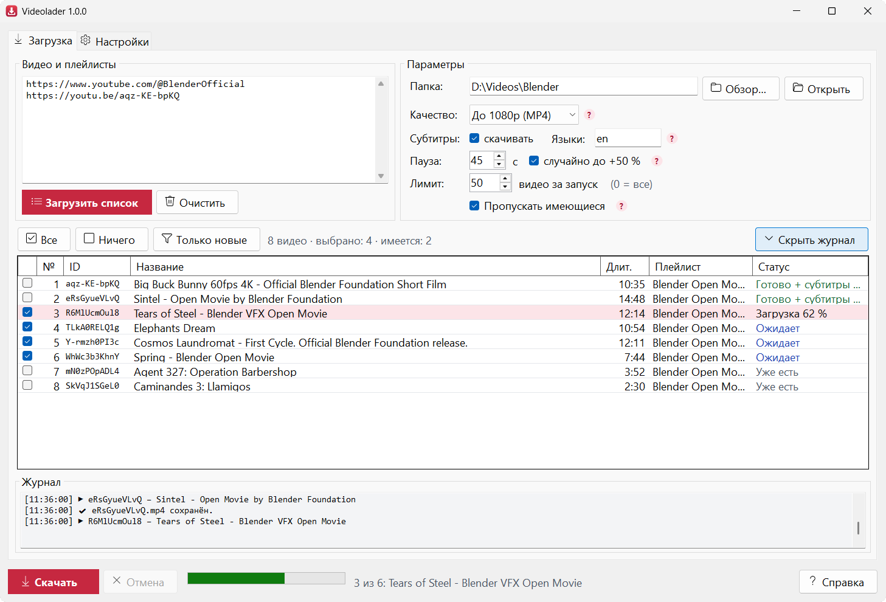
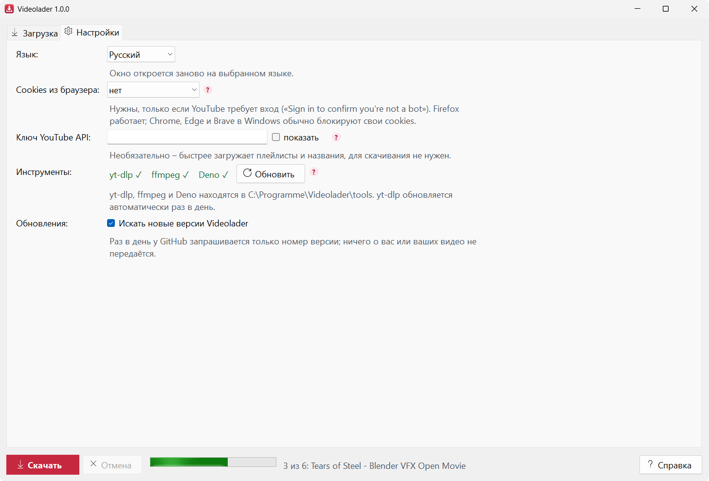
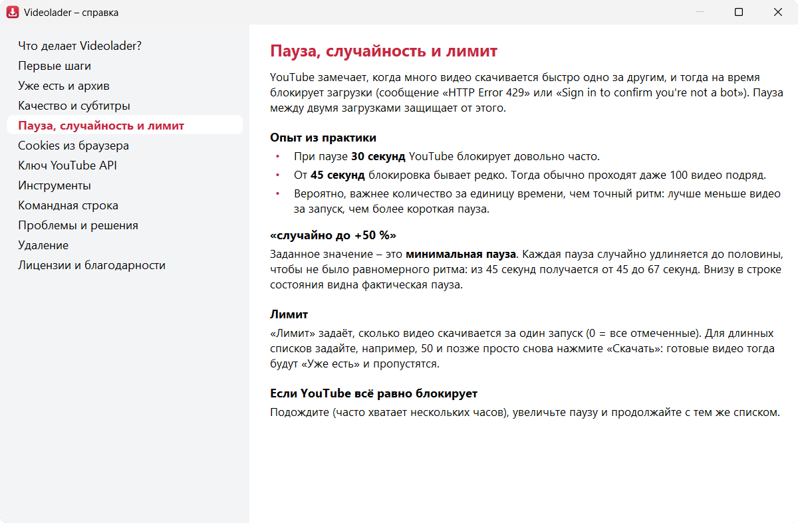

[English](README.md) | [Deutsch](README.de.md) | **Русский**

# Videolader

[](https://github.com/Schelawski/Videolader/actions/workflows/build.yml)

Небольшое приложение для Windows, которое скачивает видео и целые плейлисты с YouTube. Файлы называются
по **ID видео**, рядом с ними лежат файл с метаданными и, по желанию, субтитры в формате Whisper JSON.
Уже скачанные видео распознаются и пропускаются.



> **Videolader бесплатен.** Единственный официальный источник – этот репозиторий,
> [github.com/Schelawski/Videolader](https://github.com/Schelawski/Videolader). Копии из других источников
> могут быть изменены.

## Скачать

**[Скачать Videolader.exe](https://github.com/Schelawski/Videolader/releases/latest/download/Videolader.exe)** –
всегда новейшая версия. Установка не нужна: запустите программу, на вкладке **Настройки → Инструменты →
Установить…** скачайте инструменты – готово. Все версии и изменения: [Releases](https://github.com/Schelawski/Videolader/releases).

Требования: Windows 10 или 11, 64 бита. К каждой версии прилагается `Videolader.exe.sha256`; чтобы
проверить загрузку, выполните в PowerShell `Get-FileHash Videolader.exe` и сравните значение. При первом
запуске Windows может показать «Система Windows защитила ваш компьютер» – нажмите «Подробнее» →
«Выполнить в любом случае» (см. справку, «Проблемы и решения»).

## Возможности

- **Видео, плейлисты и каналы** – вставьте ссылки или ID, по одному на строку; плейлисты раскрываются,
  повторы объединяются.
- **Никогда дважды:** видео из папки или из `videolader-archiv.txt` пропускаются, даже если вы их
  куда-то переместили.
- Файлы называются по ID видео, метаданные – в `<ID>.info.json`, субтитры – в Whisper JSON и SRT.
- Качество от «До 480p» до «Лучшее качество» или только аудио (M4A).
- **Пауза между загрузками** со случайной добавкой до 50 % и **лимит на запуск**, чтобы YouTube не
  блокировал загрузки (см. [Советы из практики](#советы-из-практики)).
- Сразу останавливается, если cookies браузера не удаётся прочитать, и предлагает их отключить.
- Интерфейс, командная строка и справка на **английском, немецком и русском**. При первом запуске язык
  берётся из Windows (немецкий или русский, иначе английский), переключается в **Настройки → Язык**.
- Встроенная **справка** (кнопка «Справка», F1 или маленькие «?» рядом с настройками).
- Сам скачивает yt-dlp, ffmpeg и Deno и сверяет их с опубликованными контрольными суммами SHA-256.
- **Командная строка** для скриптов и планировщика заданий.
- Один самодостаточный `Videolader.exe` – устанавливать .NET не нужно.

## Как пользоваться

1. Вставьте ссылки или ID в поле «Видео и плейлисты», по одной на строку. Распознаются ссылки на видео
   (`watch?v=`, `youtu.be/`, `shorts/`, `live/`), ID видео, ссылки и ID плейлистов (`PL…`) и каналы
   (ссылка, `@name` или ID канала `UC…`; загружается вкладка канала «Видео» – Shorts и трансляции – это
   отдельные вкладки, для них нужна своя строка с `…/shorts` или `…/streams`).
2. **Загрузить список** (или Ctrl+Enter). Плейлисты раскрываются, повторяющиеся видео объединяются. Каждое
   видео получает статус: **Новое**, **Уже есть** или **Недоступно** (приватное или удалённое).
3. Отметьте видео. «Только новые» отмечает всё, чего ещё нет. Пробел и правый щелчок действуют на
   выделенные строки, двойной щелчок открывает видео в браузере.
4. **Скачать**. Видео скачиваются по очереди, с настраиваемой паузой между ними. Ошибка не останавливает
   список.

«Уже есть» означает: в папке лежит `<ID>.mp4` (или `.m4a`, `.mkv` …) **или** ID записан в
`videolader-archiv.txt`. Поэтому готовые видео можно перемещать – они всё равно не будут скачаны снова.
Если видео нужно скачать ещё раз намеренно, удалите его строку из файла архива.

### Настройки

Папка, качество, субтитры, пауза и лимит находятся на вкладке **Загрузка** рядом с полем ввода. Редко
нужное (язык, cookies, ключ API, инструменты) – на вкладке **Настройки**. «Скрыть журнал» сворачивает
журнал и даёт списку больше места.



| Настройка | Значение |
|---|---|
| Папка | Куда сохраняются видео. По умолчанию: `Videos\Videolader`. |
| Качество | Лучшее, до 1080p (по умолчанию), до 720p, до 480p или только аудио. |
| Субтитры / Языки | например `ru` или `ru,de,en`. Загруженные субтитры имеют приоритет перед автоматическими. Внимание: для автоматических субтитров на чужих языках YouTube отдаёт машинный перевод. |
| Пауза | Секунды между двумя загрузками, защищает от ограничений YouTube (HTTP 429). С «случайно до +50 %» (по умолчанию) значение – это минимальная пауза, и каждая пауза случайно удлиняется до половины (45 с → от 45 до 67 с), чтобы не было равномерного ритма. Действует и для командной строки. |
| Лимит | Не больше стольких видео за запуск (0 = все). Для длинных списков, например, 50, а в следующий раз просто продолжить: готовые видео записаны в архиве и пропускаются. |
| Cookies из браузера | Нужны, только если YouTube сообщает «Sign in to confirm you're not a bot». Надёжнее всего работает Firefox: Chrome, Edge и Brave в Windows блокируют свои cookies, пока браузер запущен, и шифруют их так, что yt-dlp обычно не может их прочитать («Could not copy Chrome cookie database»). Тогда загрузка сразу останавливается, и Videolader предлагает отключить cookies. |
| Ключ YouTube API | Необязательно. Тогда плейлисты и названия читаются через официальный API (быстро, 1 единица квоты на 50 видео). Без ключа это делает yt-dlp или интерфейс oEmbed YouTube. **Для скачивания ключ не нужен**, потому что API не отдаёт видеофайлы. |

Настройки хранятся в `Videolader.settings.json` рядом с exe (или в `%APPDATA%\Videolader`, если эта папка
защищена от записи). Ключ API там зашифрован средствами Windows DPAPI для вашей учётной записи; в другой
учётной записи или на другом компьютере его нужно ввести заново.

### Советы из практики

- При паузе **30 секунд** YouTube довольно часто блокирует загрузки. От **45 секунд** блокировка бывает
  редко – обычно проходят даже 100 видео подряд.
- Вероятно, важнее количество за единицу времени, чем точный ритм: для длинных списков лучше использовать
  **лимит** (например, 50 за запуск), чем более короткую паузу.
- Обычно **cookies не нужны**. Если всё же нужны – используйте Firefox.

### Справка

Встроенная справка простым языком объясняет все настройки и типичные проблемы, на всех трёх языках. Она
открывается кнопкой «Справка», клавишей F1 (по полю, в котором вы находитесь) или маленькими «?» рядом с
настройками. Тексты лежат в `src/Videolader.Core/Help/help.{en,de,ru}.md`.



## Что получается для каждого видео

```
D:\Videos\Blender\
  aqz-KE-bpKQ.mp4           видео (H.264 + AAC, при «Только аудио»: .m4a)
  aqz-KE-bpKQ.info.json     ID, название, канал, дата, длительность, описание, плейлист, субтитры
  aqz-KE-bpKQ.en.json       субтитры в формате Whisper (необязательно)
  aqz-KE-bpKQ.en.srt        те же субтитры в SRT (необязательно)
  videolader-archiv.txt     список всех скачанных ID
```

Файл метаданных намеренно называется `<ID>.info.json`, а не `<ID>.json`, чтобы не конфликтовать с
расшифровкой, которую [Wortlaut](https://github.com/Schelawski/Wortlaut) пишет для `<ID>.mp4` как
`<ID>.json`.

### `<ID>.info.json`

```json
{
  "id": "aqz-KE-bpKQ",
  "title": "Big Buck Bunny 60fps 4K - Official Blender Foundation Short Film",
  "url": "https://www.youtube.com/watch?v=aqz-KE-bpKQ",
  "channel": "Blender",
  "channelId": "UC…",
  "uploadDate": "2014-11-10",
  "durationSeconds": 635,
  "description": "…",
  "playlist": { "id": "PL…", "title": "Blender Open Movies", "index": 1 },
  "file": "aqz-KE-bpKQ.mp4",
  "subtitles": [
    { "language": "en", "automatic": true, "file": "aqz-KE-bpKQ.en.json", "srt": "aqz-KE-bpKQ.en.srt" }
  ],
  "downloadedAt": "2026-10-25T10:37:38+02:00"
}
```

`automatic: true` означает автоматическое распознавание речи YouTube, `false` – субтитры, загруженные
каналом.

### `<ID>.<язык>.json` (формат Whisper)

```json
{
  "text": "Добрый вечер сегодня мы поговорим",
  "segments": [
    { "id": 0, "start": 0.16, "end": 2.96, "text": "Добрый вечер" },
    { "id": 1, "start": 2.96, "end": 6.96, "text": "сегодня мы поговорим" }
  ],
  "language": "ru"
}
```

Время указано в секундах. Автоматические субтитры YouTube отдаёт как «бегущие» двухстрочные титры.
Videolader убирает повторяющиеся строки и наложения, так что каждая строка встречается ровно один раз.

## Командная строка

С аргументами `Videolader.exe` работает без окна; без аргументов открывается окно программы.

```powershell
Videolader.exe setup                                   # установить yt-dlp, ffmpeg, Deno (один раз)
Videolader.exe aqz-KE-bpKQ --out D:\Videos             # одно видео
Videolader.exe PLxxxxxxxxxxx --limit 50 --pause 45     # один плейлист, не больше 50 за запуск
Videolader.exe @ИмяКанала --list                       # только показать список канала
Videolader.exe --help --lang ru                        # все параметры, на русском
```

Не указанные параметры берутся из сохранённых настроек; командная строка их не меняет. С `--json`
Videolader пишет по одной строке JSON на видео в stdout (`id`, `status`, `title`, `file`, `error`), все
сообщения тогда идут в stderr. Коды выхода: 0 = всё в порядке, 1 = хотя бы одна ошибка, 2 = неверный
ввод, 3 = нет инструментов, 130 = отменено (Ctrl+C).

exe – оконное приложение Windows без собственной консоли. Оно подключается к консоли, из которой было
запущено, но приглашение возвращается сразу. Чтобы дождаться окончания (и получить код выхода):
`start /wait Videolader.exe …` в cmd или `Videolader.exe … | Out-Host` в PowerShell. Перенаправленный вывод
(`> file.txt`, конвейер) используется как есть.

## Инструменты

При первом запуске не хватает трёх программ. **Настройки → Инструменты → Установить…** скачивает их из
официальных релизов на GitHub в папку `tools` рядом с exe (или в `%LOCALAPPDATA%\Videolader\tools`). Каждая
загрузка сначала сверяется с контрольной суммой SHA-256, которую проект публикует в том же релизе
(`SHA2-256SUMS`, `checksums.sha256` или `.sha256sum`); если она не совпадает, ничего не устанавливается:

| Программа | Назначение |
|---|---|
| `yt-dlp.exe` | скачивает видео |
| `ffmpeg.exe`, `ffprobe.exe` | соединяет видео и звук (около 190 МБ, сборка команды yt-dlp) |
| `deno.exe` | среда выполнения JavaScript. С конца 2025 года YouTube требует, чтобы yt-dlp решал задачу на JavaScript, иначе многих форматов нет. |

Если программы уже есть в PATH, используются они. yt-dlp обновляется автоматически раз в день при
запуске, потому что YouTube часто меняется, а устаревший yt-dlp – самая частая причина ошибок. **Обновить**
делает это сразу (включая Deno).

## Сборка

Требование: .NET 10 SDK в Windows.

```powershell
dotnet test
dotnet publish src\Videolader -c Release -o publish
```

Результат: `publish\Videolader.exe`, один файл со встроенным .NET, без установки.

### Выпуск версии

1. Перенесите записи из `## [Unreleased]` в [CHANGELOG.md](CHANGELOG.md) в новый раздел `## [1.2.0]`
   (версия без «v») и сделайте коммит.
2. Необязательный пробный прогон: **Actions → Release → Run workflow** с номером версии собирает всё и
   сохраняет `Videolader.exe`, контрольную сумму и описание выпуска как артефакт, ничего не публикуя.
3. Поставьте тег на коммит и отправьте его:
   ```powershell
   git tag v1.2.0
   git push origin v1.2.0
   ```
4. [release.yml](.github/workflows/release.yml) собирает и тестирует, записывает версию в `Videolader.exe`
   (заголовок окна, `--version`, свойства файла), проверяет её и создаёт выпуск на GitHub с
   `Videolader.exe`, `Videolader.exe.sha256` и разделом из журнала изменений в качестве описания.

Тег с суффиксом, например `v1.3.0-beta.1`, становится предварительной версией, и ссылка
`latest/download` на него не ведёт. Если для версии нет раздела в журнале изменений, выпуск прерывается
до публикации.

## Устройство

```
src/Videolader.Core   логика без интерфейса (net10.0, тесты работают и в Linux)
  InputParser         ссылки/ID → видео, плейлист, канал
  VideoResolver       раскрыть плейлисты, получить названия (API → yt-dlp/oEmbed как запасной вариант)
  YtDlpCommandLine    все аргументы yt-dlp в одном месте
  DownloadJob         скачать одно видео, записать info.json и субтитры, вести архив
  Subtitles           json3/VTT → фрагменты → Whisper JSON и SRT
  VideoLibrary        «уже есть?» (файл или архив)
  ToolLocator/-Installer  найти или скачать yt-dlp, ffmpeg, Deno (с проверкой контрольной суммы)
  UiText, Help/       все видимые тексты и справка на трёх языках
src/Videolader        интерфейс WinForms (MainForm, HelpForm)
tests/Videolader.Tests  тесты xUnit
```

Во время загрузки временные файлы и исходные данные всегда лежат на локальном диске в
`%LOCALAPPDATA%\Videolader\temp` и затем удаляются, даже если папка находится на сетевом диске (там yt-dlp
не справляется уже с записью небольших файлов и выдаёт «Errno 22»). Прерванные загрузки при следующей
попытке продолжаются оттуда.

## Правовые вопросы

Videolader – независимый проект и **не связан с YouTube или Google**. «YouTube» – товарный знак
Google LLC.

Вы сами отвечаете за соблюдение авторского права и условий использования YouTube при скачивании. Они в
принципе разрешают скачивание только средствами самого YouTube. Без проблем – для собственных материалов,
свободных материалов (например, под лицензией Creative Commons) или с разрешения правообладателей.

Пример видео `aqz-KE-bpKQ` и другие фильмы на снимках экрана – открытые фильмы Blender Foundation
(Creative Commons CC BY).

## Конфиденциальность

Videolader не собирает данных и ничего не отправляет разработчику: ни аккаунта, ни статистики, ни рекламы.
Соединения устанавливаются только с:

- **YouTube**, чтобы загружать списки, названия и видео,
- **YouTube Data API** от Google, только с вашим собственным ключом API,
- **GitHub**, чтобы скачивать и обновлять yt-dlp, ffmpeg и Deno.

Cookies из браузера читаются, только если выбран браузер, и передаются только yt-dlp. Настройки и ключ API
остаются на компьютере, ключ – в зашифрованном средствами Windows DPAPI виде.

## Лицензии

Videolader распространяется по [GNU General Public License, версия 3](LICENSE). Инструменты не поставляются
вместе с ним, а скачиваются при установке с их официальных страниц и имеют собственные лицензии:

| Инструмент | Лицензия | Источник |
|---|---|---|
| yt-dlp | [Unlicense](https://github.com/yt-dlp/yt-dlp/blob/master/LICENSE) | [github.com/yt-dlp/yt-dlp](https://github.com/yt-dlp/yt-dlp) |
| FFmpeg | [GPL](https://github.com/yt-dlp/FFmpeg-Builds#ffmpeg-static-auto-builds) (сборка команды yt-dlp) | [github.com/yt-dlp/FFmpeg-Builds](https://github.com/yt-dlp/FFmpeg-Builds) |
| Deno | [MIT](https://github.com/denoland/deno/blob/main/LICENSE.md) | [github.com/denoland/deno](https://github.com/denoland/deno) |

## Участие

Сообщения об ошибках, идеи, переводы и код приветствуются – см. [CONTRIBUTING.md](CONTRIBUTING.md) (на
английском). Об уязвимостях, пожалуйста, сообщайте конфиденциально, см. [SECURITY.md](SECURITY.md).
